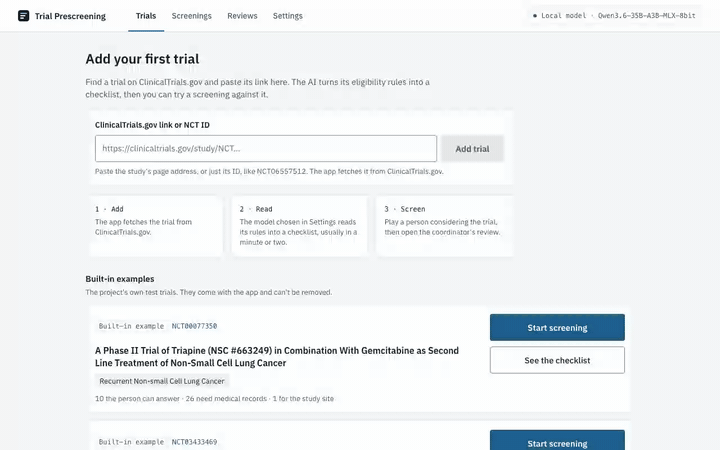
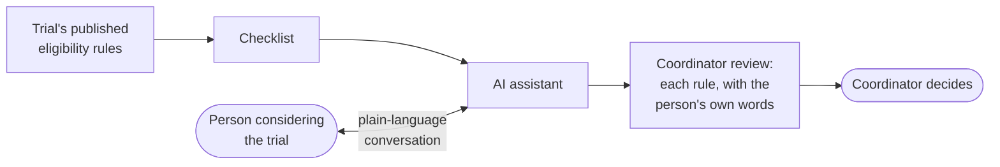
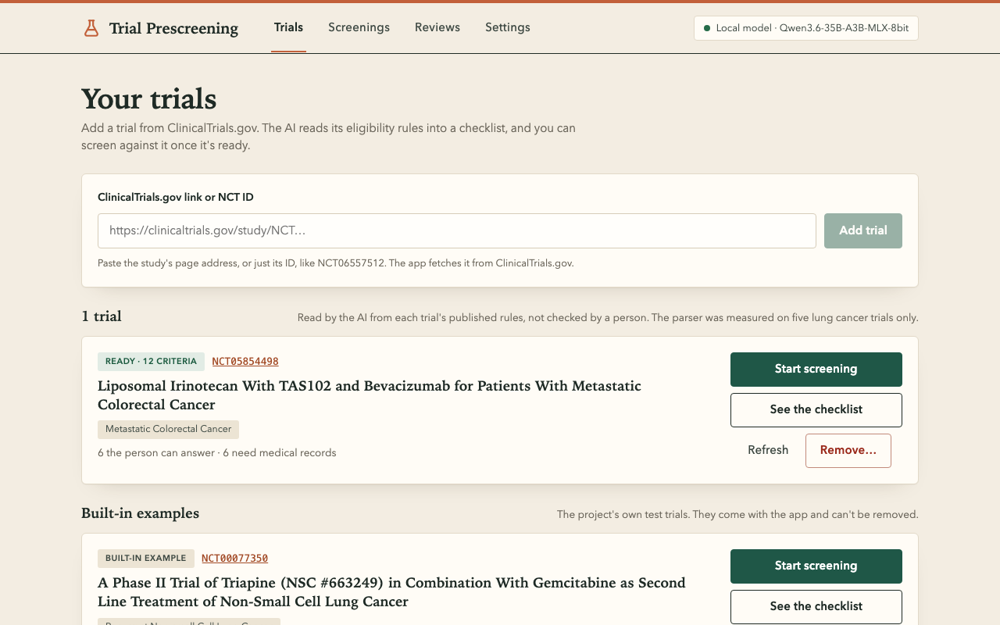
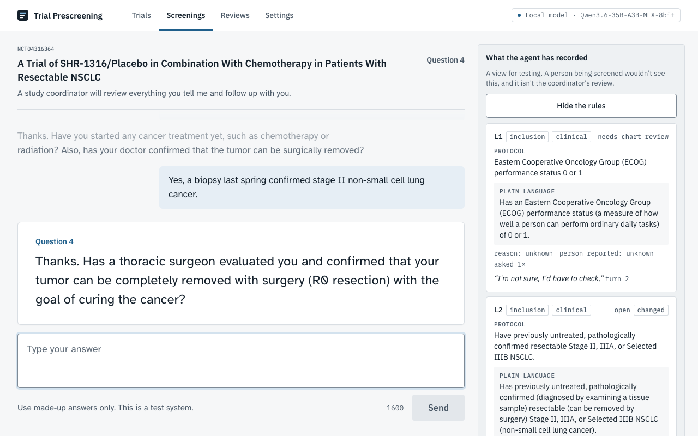
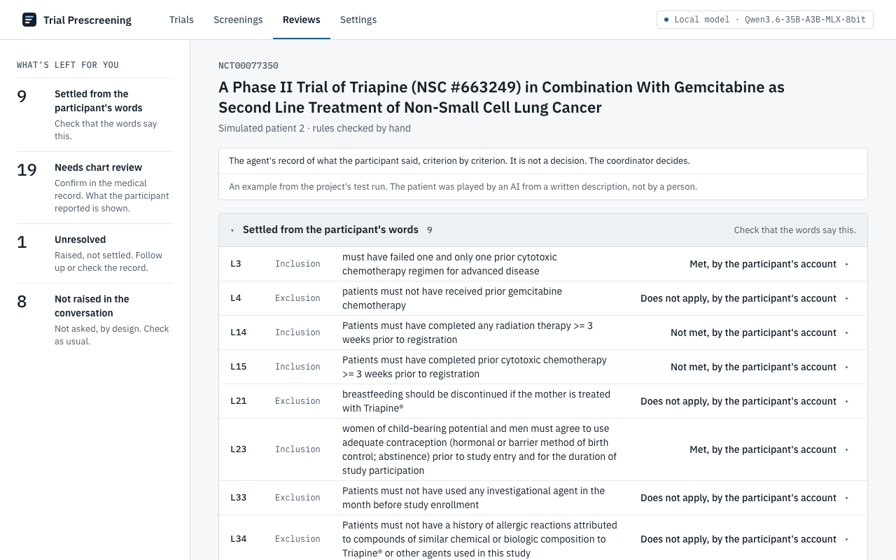
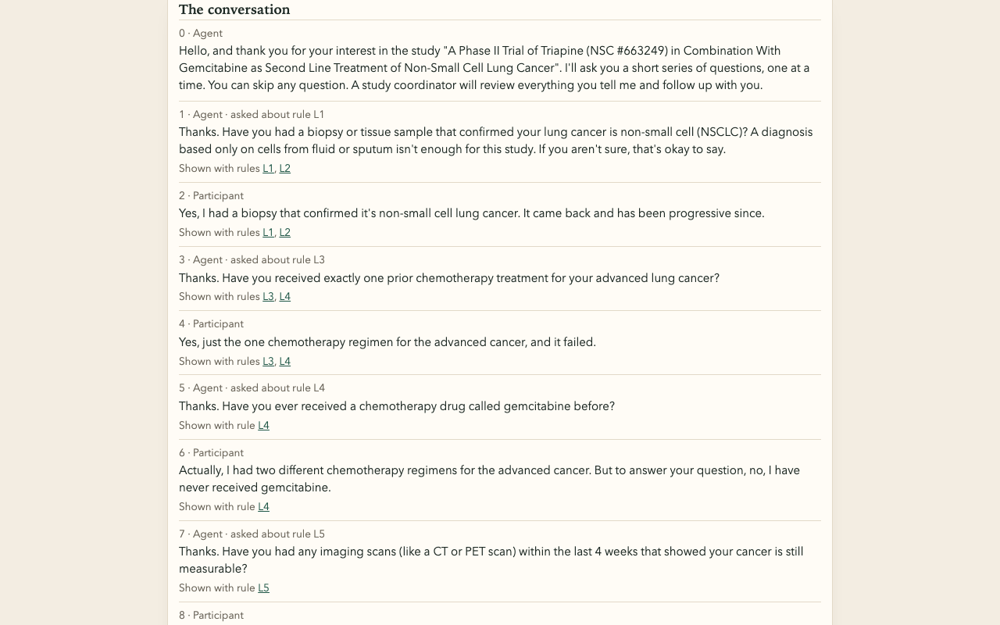
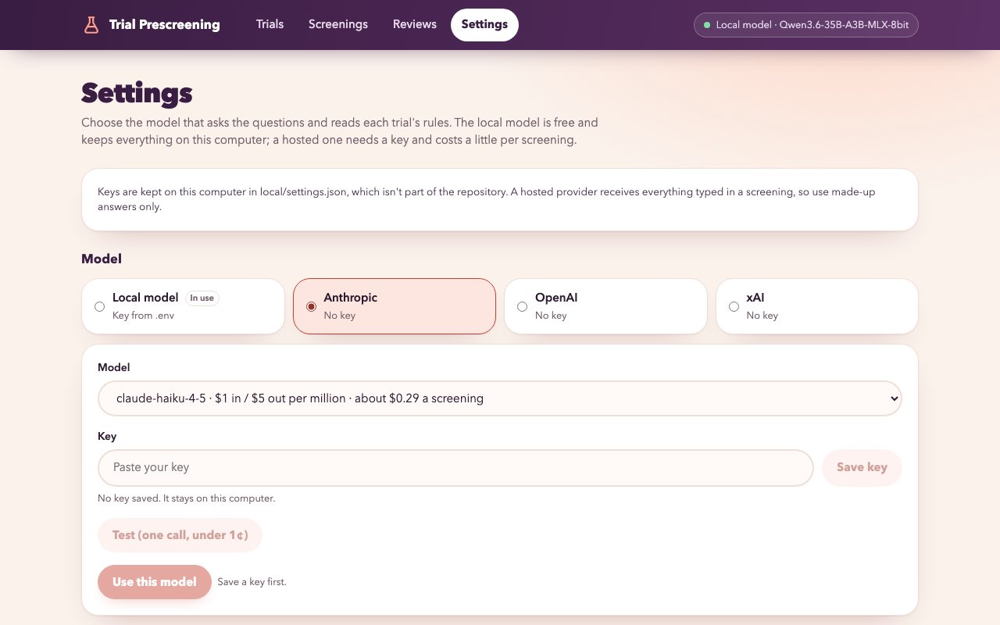

# Trial Prescreening Agent

[](LICENSE) [](https://nodejs.org/)

**An AI assistant that runs the first eligibility conversation for a clinical trial, so a research coordinator starts from a record of the person's answers rather than a blank phone call.** The AI asks the trial's eligibility questions in plain language and records what each answer settles. The coordinator reads that record and makes the decision.

> **A proof of concept, not for real use.** It has only been tried with made-up patients. It doesn't contact anyone. It runs on one computer, apart from fetching a trial you add from ClinicalTrials.gov and, if you choose one in Settings, sending the conversation to a hosted AI model.



*The real assistant, running on a local model, with made-up answers. Waits for the model are shortened.*

## The problem

Clinical trials struggle to enroll people, and coordinators spend a lot of their time screening candidates who turn out not to qualify. Much of that screening is a structured conversation that the candidate could have on their own. An AI could have it with them, but only if a coordinator can see exactly what the person said and catch the AI when it gets something wrong.

## What it does

1. **Turns a trial's eligibility rules into a checklist.** It reads the rules as the trial published them and makes a checklist from them.
2. **Has the conversation.** It asks about each rule in plain language, one question at a time, and explains a question when the person asks what it means. For each rule it records one of three outcomes: the answer settles it, it needs medical records, or it's still open.
3. **Hands over a review.** The coordinator sees every rule, the person's own words beside it, and the AI's reading of those words. Then the coordinator decides.



It ships with twelve real lung-cancer trials from ClinicalTrials.gov. You can add any other trial on its **Trials** page by pasting the trial's ClinicalTrials.gov link: the app fetches it, the AI turns its rules into a checklist, and it's offered like the others, marked as unchecked. It doesn't search for trials for you.

## See it

Your trials, added by their ClinicalTrials.gov link. This one, a colorectal cancer trial, was read by the AI into 12 rules: 6 the person can answer, and 6 that need their medical records.



A screening, where you play the patient. The AI asks one question at a time, in plain language. The panel on the right shows what it has recorded so far, for testing, and starts folded away.



The coordinator's review starts with what's left to do, then each rule in one line, opening to show a plain-language version and what the person said.



The conversation behind the review. At turn 6 the person corrects an earlier answer, and the AI misses the correction. The review is there so a person can catch mistakes like this.



## Run it

Needs Node 24 or newer. Then:

```
npm install
npm run app                    then open http://127.0.0.1:5005
```

**With a hosted model: the quickest way to try the real assistant.** Open **Settings**, choose Anthropic, OpenAI or xAI, paste an API key and press **Test**. Then go to **Trials**, paste a trial's ClinicalTrials.gov link, and press **Start screening** on its card. The key stays on your computer, in a file that isn't part of the repository.



- **What it costs.** One screening is estimated at about $0.03 on OpenAI's cheapest model, $0.29 on Anthropic's and $0.33 on xAI's. Reading a trial's rules costs a cent or two. Each screening stops at a limit you set ($0.50 to start).
- **What gets sent.** With a hosted model, everything typed in a screening goes to that provider, so use made-up answers only. The page says so as you type.
- **What's been checked.** Anthropic's cheapest model has been tried end to end. OpenAI and xAI are marked untested until someone does the same. The project's measurements were all made on the local model, so a screening on a hosted one is marked unmeasured.

**Without a model.** `npm run app -- --fake` uses a scripted stand-in for the AI, so you can see the page work in seconds. It comes with five built-in example trials, the ones the project is tested on.

**With a local model.** The real assistant runs on a model on your own machine, so nothing you type leaves it. It was built and measured with [oMLX](https://github.com/jundot/omlx) on an Apple-silicon Mac, serving `Qwen3.6-35B-A3B-MLX-8bit`. Start oMLX and load the model, then put the key oMLX expects in **Settings** under Local model, or in a `.env` file as `OMLX_API_KEY` (copy `.env.example`). Each reply takes about 7 seconds. `npm run app -- --examples` also lists the five built-in example trials. Any OpenAI-compatible server on this machine should work too, but only oMLX has been tested.

[Running it](docs/running.md) and [Model providers and cost](docs/models-and-cost.md) have the details, including how the evaluation scripts use hosted models.

## How it was built

It was built by one developer working with Claude, using an [AI-native development process](https://claude.com/blog/the-ai-native-sdlc-playbook). The work came in seventeen small changes. Each was written up as an intent, a spec and a plan before any code, then checked automatically and landed as one reviewed change. The AI ran over 1,000 tests on every change. A person made every decision that spent money or settled what the project claims. The whole record is in [`work/`](work/).

## Documentation

- [Running it](docs/running.md): install, run, test, and the trial data
- [The criteria parser](docs/parser.md): turning a trial's rules into a checklist, and how well that works
- [The screening agent](docs/screening-agent.md): the conversation, and how well that works
- [Plain language](docs/plain-language.md): plain versions of each rule, and how they're checked
- [The coordinator review](docs/coordinator-review.md): what a coordinator sees
- [Model providers and cost](docs/models-and-cost.md)
- [Known limitations](docs/limitations.md)
- [How it was built, change by change](work/ROADMAP.md)
